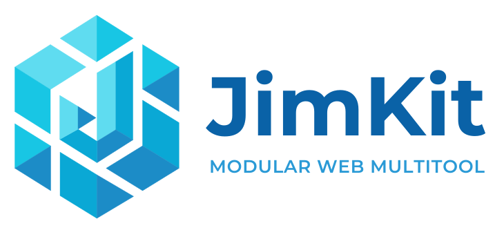
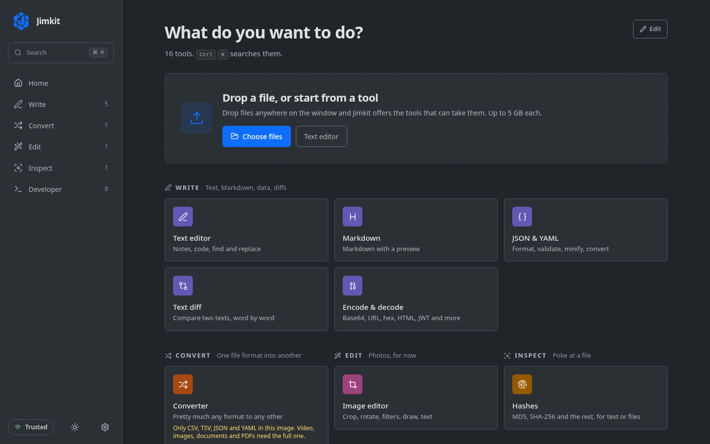
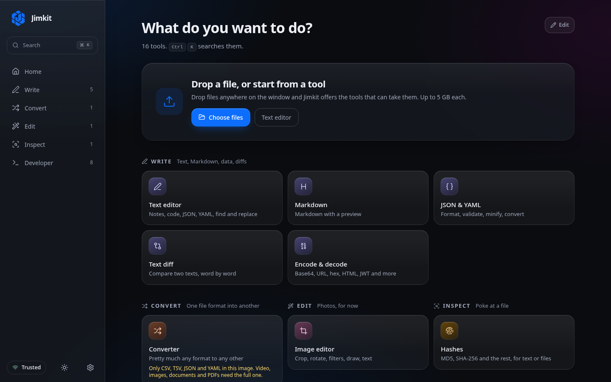
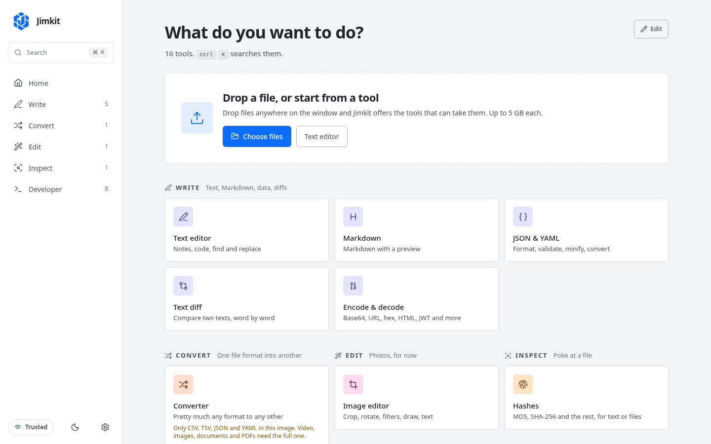
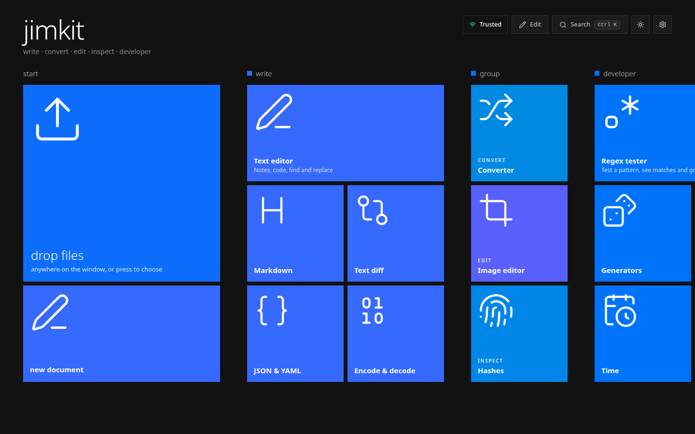

<p align="center"></p>

# Jimkit

A self-hosted toolkit you extend with addons. Convert, edit, write and inspect files from one place, from a browser or a phone.
It runs in Docker or a Proxmox container, and a new feature is added as a folder.

> **Status: pre-release (0.1).** It works and is tested, but the addon API may still change before 1.0.

**Included**

| | |
|---|---|
| **Converter** | images (incl. HEIC), video, audio, documents, PDFs, spreadsheets, data files: ffmpeg, ImageMagick, LibreOffice, pandoc, poppler. Hardened, queued, with per-visitor limits. |
| **Text & data** | one text editor for plain text, Markdown, JSON and YAML (find and replace, line numbers, live Markdown preview, a formatter with a tree view), a word-level diff, Base64/URL/hex/JWT encoders. |
| **Image editor** | crop, straighten, resize and squish, adjust, filters, draw, rotatable text, export at any size. |
| **Hashes** | MD5, SHA-1/256/384/512, CRC-32 and HMAC of text or any file, streamed so big files are fine. |
| **Developer tools** | regex tester, UUID/ULID/password generators, timestamps, colours and contrast, QR codes, cron, number bases, URL parser. |

Four looks (Basic, Paper, Glass, Metro; all but Basic are kits you can switch off), each in dark and light, with seven accent colours or any colour you pick. Press <kbd>Ctrl</kbd>+<kbd>K</kbd> to search every tool.

<p align="center">
  
  
  
  
</p>

## Install

**Docker** (about two minutes, plus the image build):

```sh
git clone https://github.com/jim-kit/jimkit.git && cd jimkit
./install/install.sh
```

The script asks a few questions (which variant, the port, whether a reverse proxy is in front, an optional unlock code), builds
the image, starts it, waits until it answers and prints the address. `--yes` skips the questions, `--minimal` installs the lite image with only the Basic look. Later, `jimkit update` shows what changed, builds the new version beside the running one, swaps it in and goes back if it does not come up healthy; `jimkit delete` takes it away again.

**Proxmox** (run on the Proxmox host; it creates an unprivileged LXC with Docker inside and runs the installer in it):

```sh
git clone https://github.com/jim-kit/jimkit.git && cd jimkit
bash install/proxmox-lxc.sh --source https://github.com/jim-kit/jimkit.git
```

Two variants, same code:

| Variant | Adds | Image |
|---|---|---|
| `lite` | nothing: text, hash and image tools, plus CSV/JSON/YAML conversion | ~400 MB |
| `full` (default) | ffmpeg, ImageMagick, LibreOffice, pandoc, poppler, librsvg: the converter works on everything | ~1.8 GB |

More: [docs/install.md](docs/install.md) · [docs/configuration.md](docs/configuration.md) · [docs/reverse-proxy.md](docs/reverse-proxy.md)

## Read this before you expose it to the internet

Jimkit decides who is "on your network" from the connection's address. Behind a reverse proxy that setting
(`JIMKIT_PROXY_HOPS`) must be right, or every visitor looks local. The installer asks; [docs/security.md](docs/security.md)
explains what is and isn't protected.

## Add kits or make your own ones

Kits add tools and looks. Open **Kits** (from your own network) to browse the registry, or paste a GitHub `user/name`: the tools appear
straight away, no rebuild. Reviews and versions come with the registry. [docs/kits.md](docs/kits.md) covers what is checked on install.

```sh
node cli/jimkit.mjs kits new my-tool       # a working tool that calls its own server route
npm run dev
node cli/jimkit.mjs kits pack addons/my-tool   # dist/jimkit-kit.json, for a GitHub release
```

A kit (in the code, an addon) is a folder with a manifest, a React component and, if it needs one, a server route file. See
[docs/addons.md](docs/addons.md) for a tutorial that builds one, and [docs/architecture.md](docs/architecture.md) for how it all
fits together.

## Develop

The website for Jimkit itself (a static page with the tools running in it) is `apps/site`: `npm run dev:site`.

```sh
npm ci
npm run dev        # http://localhost:3000   (?tier=public previews a visitor from outside your network)
npm test           # unit tests
npm run typecheck
```

Node 22 or newer.

## License

The core app, first-party addons, CLI and installers are **AGPL-3.0-or-later** ([LICENSE](LICENSE)). The addon SDK
(`packages/sdk`) and UI kit (`packages/ui`) are **MIT**, so your addon can use any license. If you modify Jimkit and offer it to
other people over a network, AGPL asks you to share your changes. Running it for yourself, your family or your company
changes nothing.
